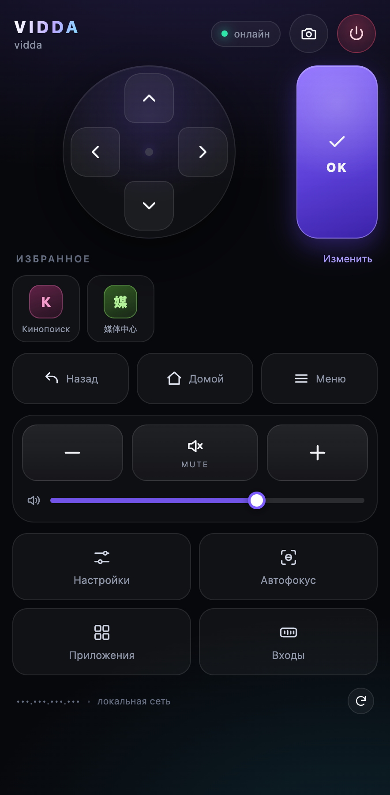
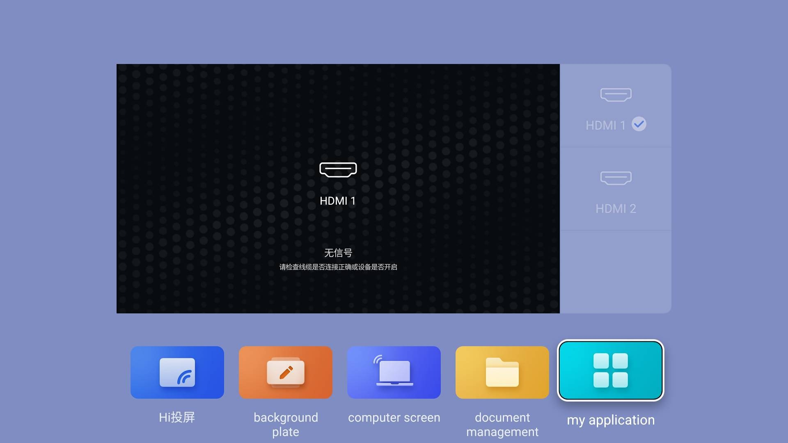

# Vidda_remote_cn_node — пульт китайского проектора Vidda

Локальный веб-пульт для **китайского проектора Vidda (Hisense, VIDAA)**.
Работает целиком в домашней сети: Node.js-сервер общается с MQTT-брокером
проектора, а интерфейс открывается с телефона как обычная страница. Без облака,
аккаунта и официального приложения.

> Проверено на проекторе с DLNA-моделью `HiSmart` и прошивкой
> `V0000.00.01R.P1228`. Другие модели и регионы могут отличаться.
>
> Проект не аффилирован с Vidda, Hisense или их дочерними компаниями.


## Возможности

- D-pad, OK, «Назад», «Домой», «Меню».
- Громкость ±, mute, автоповтор при удержании.
- Кнопка скриншотов.
- **Настройки проектора** — открывает встроенное меню (`KEY_SETTING`).
- **Автофокус** — экспериментальная кнопка (`KEY_AUTOFOCUS`).
- **Избранное** — экспериментальная кнопка (`KEY_FAVORITE`).
- **Входы** — переключение HDMI 1 / HDMI 2 / ТВ через `changesource` (на этом
  экземпляре не сработало; в окне есть переход на домашний экран).
- **Экран проектора** — снимок экрана по MQTT по кнопке «Обновить».
- **Питание** — выключение командой и включение по Wake-on-LAN.
- Автообнаружение проектора по SSDP; IP и client ID сохраняются в `config.json`.
- Статус подключения, состояние интерфейса и громкость (если прошивка её отдаёт).
- PWA: можно добавить на домашний экран телефона.

## Скриншоты

| Пульт | Домашний экран проектора |
|---|---|
|  |  |

| Меню настроек (`KEY_SETTING`) | Снимок экрана через MQTT |
|---|---|
|  |  |

## Быстрый старт

Нужен Node.js 18+ и Git.

```bash
git clone https://github.com/sergvax/Vidda_remote_cn_node.git
cd Vidda_remote_cn_node
npm install
npm start
```

Открыть на компьютере:

```
http://localhost:3000
```

С телефона (та же Wi-Fi сеть):

```
http://<IP-компьютера>:3000
```

IP компьютера:

```bash
ipconfig getifaddr en0
```

При первом запуске пульт сам ищет проектор по SSDP. Если не нашёл — нажми
кнопку-статус в правом верхнем углу. IP и client ID можно задать вручную:

```bash
VIDDA_IP=<IP-проектора> VIDDA_CLIENT_ID=<32-hex-client-id> npm start
```

## Кнопки

| Кнопка | Команда | Статус |
|---|---|---|
| Питание | `KEY_POWER` | ✅ выключает (включение — WoL) |
| Стрелки, OK | `KEY_UP/DOWN/LEFT/RIGHT`, `KEY_OK` | ✅ |
| Назад / Домой / Меню | `KEY_RETURNS`, `KEY_HOME`, `KEY_MENU` | ✅ |
| Громкость ± / Mute | `KEY_VOLUMEUP`, `KEY_VOLUMEDOWN`, `KEY_MUTE` | ✅ |
| Настройки | `KEY_SETTING` | ✅ открывает меню проектора |
| Автофокус | `KEY_AUTOFOCUS` | ⚠️ экспериментально |
| Избранное | `KEY_FAVORITE` | ⚠️ экспериментально |
| Входы | `changesource` + `sourceid` | ❌ на этом проекторе не переключил |
| Яркость ± | `KEY_BRIGHTUP/DOWN` | ❌ не поддерживается |
| Задачи, Центр | `KEY_MULTITASK`, `KEY_CONTROL_CENTER` | ❌ не поддерживается |

Подробный разбор кодов и топиков — в [docs/KEYMAP.md](docs/KEYMAP.md) и
[docs/PROTOCOL.md](docs/PROTOCOL.md).

### Если автофокус не срабатывает

В меню проектора есть пункт **Auto Focus**. Он открывается кнопкой
«Настройки» → `Auto Focus`. На этой прошивке прямой код `KEY_AUTOFOCUS`
подтвердить не удалось, поэтому кнопка помечена как экспериментальная.

### Если «Входы» не переключают

На проверенном проекторе `changesource` с `sourceid` `3`/`4` не изменил вход
(скриншоты до и после совпали). В окне «Входы» есть кнопка **«Домой»**: она
открывает домашний экран, где входы переключаются в боковой панели
`HDMI 1 / HDMI 2`.

## Экран проектора

Кнопка с камерой в шапке запрашивает снимок экрана через MQTT:

```
/remoteapp/tv/hiservice_cmd/<clientId>/actions/screenshot
```

Ответ приходит бинарным JPEG в топик:

```
/remoteapp/mobile/<clientId>/hiservice/data/screenshot
```

Интерфейс делает один снимок при открытии окна и обновляет его по кнопке
«Обновить». Автообновление специально не включено: проектор ограничивает частоту
снимков и после серии быстрых запросов начинает возвращать пустой ответ на
несколько минут. Пульт показывает понятную ошибку и продолжает работать.

## Включение проектора

MQTT-брокер доступен только когда проектор включён, поэтому `KEY_POWER` умеет
только выключать. Для включения пульт отправляет **Wake-on-LAN** magic packet на
MAC-адреса из `config.json`:

```json
"macs": ["<MAC Ethernet>", "<MAC Wi-Fi>"]
```

MAC-адреса не захардкожены: если `macs` пустой, кнопка «Включить» вернёт
понятную ошибку и попросит заполнить `config.json`.

На проекторе должно быть разрешено сетевое ожидание (Network Standby / Wake on
LAN). В служебной конфигурации этого экземпляра был флаг `network_wakeup=0`,
поэтому включение по WoL не подтверждено — проверяй кнопкой «Включить».

## API

```
GET  /api/status               состояние, источники, громкость
POST /api/discover             повторный поиск проектора
POST /api/key                  {"key":"KEY_VOLUMEUP"}
POST /api/source               {"id":"3"}   (3 = HDMI 1, 4 = HDMI 2, 0 = ТВ)
POST /api/wake                 Wake-on-LAN
GET  /api/screenshot?fresh=1   JPEG-снимок экрана
POST /api/connect              переподключить MQTT
```

Пример:

```bash
curl -X POST http://localhost:3000/api/key \
  -H 'Content-Type: application/json' \
  -d '{"key":"KEY_SETTING"}'
```

## Конфигурация

`config.json` создаётся автоматически и не попадает в Git. Пример —
[`config.example.json`](config.example.json).

| Поле | Назначение |
|---|---|
| `ip` | IP проектора |
| `clientId` | UDN из DLNA без `uuid:` и дефисов |
| `macs` | MAC-адреса для Wake-on-LAN |
| `sources` | список входов: `id` — `sourceid` из протокола VIDAA |

Переменные окружения:

| Переменная | По умолчанию | Назначение |
|---|---|---|
| `PORT` | `3000` | Порт веб-пульта |
| `VIDDA_IP` | автопоиск | IP проектора |
| `VIDDA_PORT` | `36669` | MQTT-порт проектора |
| `VIDDA_CLIENT_ID` | автопоиск | UDN без дефисов |
| `VIDDA_USER` | `hisenseservice` | MQTT-логин |
| `VIDDA_PASS` | `multimqttservice` | MQTT-пароль |

## Ограничения

- **Громкость.** Проектор не присылает системную громкость ни по MQTT, ни по
  DLNA (DLNA всегда отдаёт 50). Пульт показывает значение, только если прошивка
  прислала broadcast; иначе в футере написано «локальная сеть».
- **Состояние.** Надёжно определяется только смена приложения (`appswitch`) и
  некоторые broadcast-состояния (`launcher`, `remote_setting`, `sourceswitch`).
- **Автофокус и избранное.** Точные коды не подтверждены: официальное приложение
  отправляло эти команды через облако, а не в локальный MQTT. Проверенные
  `KEY_AUTO_FOCUS`, `KEY_FOCUS`, `KEY_AF`, `KEY_FAV`, `KEY_FAVOURITE`, `KEY_HEART`
  видимой реакции не дали.
- **Включение.** Wake-on-LAN зависит от настроек проектора.
- **Скриншоты.** Проектор ограничивает частоту снимков: после серии быстрых
  запросов несколько минут возвращает пустой ответ.

## Как это работает

Проектор держит MQTT-брокер на порту `36669` со статическими кредами:

```
username: hisenseservice
password: multimqttservice
```

Команды идут в топик, где `clientId` — это UDN проектора из DLNA-описания без
`uuid:` и дефисов:

```
/remoteapp/tv/hiservice_cmd/<clientId>/actions/sendkey
payload: KEY_SETTING
```

Стандартный VIDAA-топик `remote_service/sendkey` на этом проекторе игнорируется.
Полный разбор протокола, найденные топики и эксперименты — в
[docs/PROTOCOL.md](docs/PROTOCOL.md).

## Структура проекта

```
Vidda_remote_cn_node/
├── server.js              Node.js-сервер, SSDP, MQTT, API
├── public/                HTML-пульт
│   ├── index.html
│   ├── app.js
│   ├── style.css
│   ├── manifest.webmanifest
│   └── icon.svg
├── docs/
│   ├── PROTOCOL.md        разбор протокола и эксперименты
│   ├── KEYMAP.md          таблица кодов кнопок
│   └── screenshots/       скриншоты пульта и проектора
├── tools/                 Python-утилиты для исследования
├── config.example.json
└── package.json
```

## Инструменты исследования

В [`tools/`](tools/) лежат скрипты, которыми искали протокол:

```bash
python3 -m pip install -r tools/requirements.txt
python3 tools/send_key.py KEY_SETTING
python3 tools/screenshot.py -o screen.jpg
python3 tools/sniff.py -d 60
python3 tools/probe_key.py KEY_AUTOFOCUS
python3 tools/wake.py
```

Они читают `config.json` и работают напрямую с MQTT проектора.

## Безопасность

Пульт не имеет авторизации и доступен всем в локальной сети. Не выставляй порт
`3000` в интернет. Если это важно — reverse-proxy с паролем или токен в API.

## Благодарности

- `pyvidaa` — описание VIDAA-протокола и `changesource`.
- `vidda_fish` — рабочий топик `hiservice_cmd`.
- Официальный веб-пульт HiSmart — базовый список `KEY_*`.

## Лицензия

MIT — см. [LICENSE](LICENSE).

Проект не аффилирован с Vidda, Hisense, VIDAA и их дочерними компаниями.
Названия продуктов и товарные знаки принадлежат их владельцам. Всё
взаимодействие идёт с собственным устройством в локальной сети.
